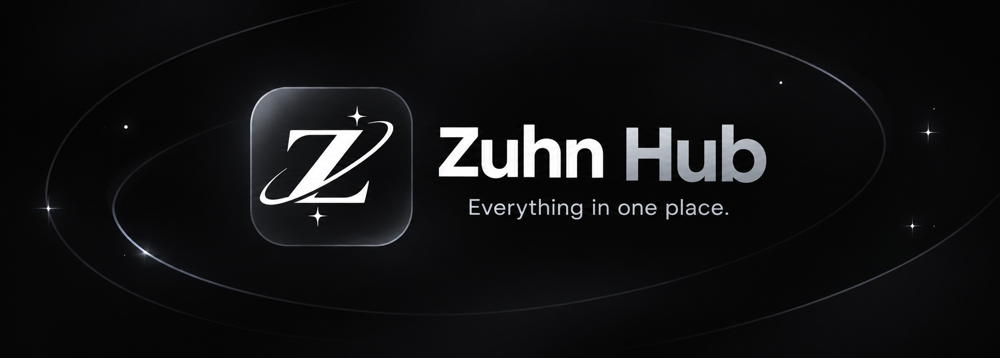

<p align="center">
  
</p>

<p align="center">
  <b>Your #1 Premier Script Hub — Everything in one place.</b><br>
  <i>Engineered for peak performance, modern aesthetics, and seamless execution.</i>
</p>

<p align="center">
  
  
  
</p>

---

## 🚀 Quick Launch

Execute the official loader directly in your script executor:

```lua
loadstring(game:HttpGet("https://raw.githubusercontent.com/verroxz/zuhn-hub/main/ZuhnHub.luau"))()
```

---

## ⚡ Core Highlights

- **Starlight Interface Suite**: Sleek, ultra-responsive dark-mode interface built for speed and zero frame drops.
- **Dynamic Entity & Player Radar**: Real-time player tracking, distance metrics, and permission hierarchy indicators (Owner / Admin / Staff / Mod / Dev).
- **Automated Communication Suite**: Advanced messaging tools with automated formatting and intelligent staff protection bypass safeguards.
- **Utility & Movement Modules**: Integrated modifications engineered with clean memory cycles to keep client performance stable.
- **Asset Optimization**: Ultra-lightweight footprint with instant custom asset hydration.

---

## 🛡️ Requirements & Compatibility

- Any modern Luau client executor supporting standard asset and closure APIs (`getcustomasset`, `writefile`, `getgc`, `debug`).
- Multi-platform ready (PC & Mobile executors).

---

<p align="center">
  <sub>Zuhn Hub © 2026. Built with precision.</sub>
</p>
